<div align="center">

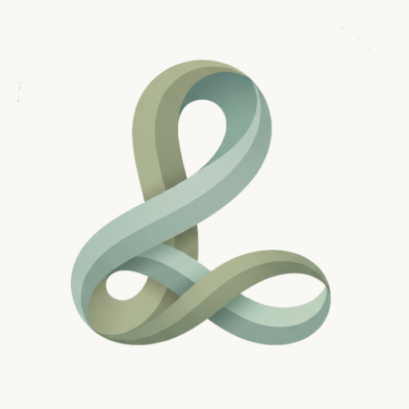

# Loom

**Your whole life, woven into one offline-first workspace.**

A modular, Notion-inspired productivity workspace and life tracker for Android, built entirely with Jetpack Compose.

[](https://kotlinlang.org)
[](https://developer.android.com/jetpack/compose)
[-3DDC84?logo=android&logoColor=white)](https://developer.android.com)
[](LICENSE)
[](https://github.com/ArianArsenal/Loom/releases/latest)

[Features](#-features) • [Screenshots](#-screenshots) • [Tech Stack](#-tech-stack) • [Architecture](#-architecture) • [Getting Started](#-getting-started)

</div>

<p align="center">
  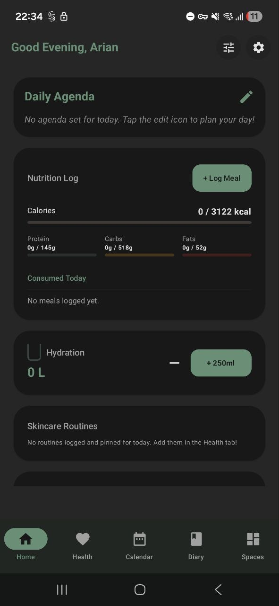
  &nbsp;
  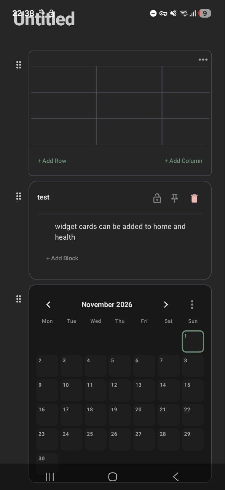
  &nbsp;
  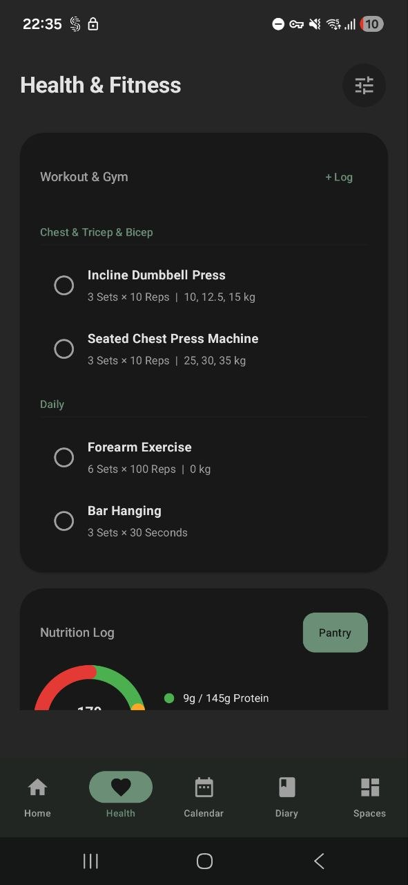
  &nbsp;
  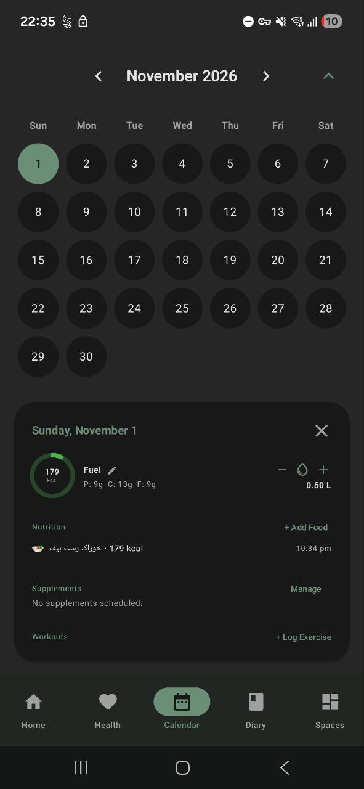
</p>

---

## 📖 About

**Loom** brings your notes, plans, habits and health into a single app — without accounts, ads, or the cloud. Everything lives on your device.

At its heart are **Spaces**: free-form pages you build from rich, interactive blocks — tables, databases, kanban boards, timelines, galleries, charts, sketches, goal trackers and more. Around them, Loom adds a personal dashboard, a health and habit tracker, a calendar, and a private diary, so your day-to-day life and your projects share one home.

- 🔒 **Private by design** — 100% offline, local Room database, PIN & biometric lock.
- 🧩 **Modular** — 30+ block types you can nest, lock, and rearrange.
- 💾 **Yours to keep** — full JSON export / import for backup and restore.

---

## ✨ Features

### 🧩 Spaces & Blocks
Build pages the way you think. Every Space is a canvas of composable blocks:

| Category | Blocks |
|---|---|
| **Text** | Text, Headings (H1–H4), Bulleted & Numbered lists, To-do, Toggle, Callout, Quote, Divider, Table of Contents |
| **Data** | Table (resizable columns, `SUM` / `AVG` / `MIN` / `MAX` footers), Database (typed properties), Chart (bar, line, pie), Progress / goal tracker |
| **Planning** | Kanban board, Weekly Timeline, Calendar, Countdown, Pomodoro Timer (with ambient focus sounds) |
| **Media** | Image, Gallery (lightbox + custom colour tiles), Video, Audio, File, Sketch canvas |
| **Dev & Web** | Code (syntax highlighting), Math, Link, Bookmark (rich previews) |
| **Structure** | Cards (nested blocks), Space links (pages inside pages) |

- **Database properties:** Text, Number, Checkbox, Date, Select, Multi-select, Status, Progress, Formula, URL, Media, and Space relations.
- **Rich text** with bold, italic, underline, strikethrough, colours and links.
- **Timeline events** open into their own full page of blocks.
- **Lock** individual blocks or entire Spaces to prevent accidental edits.
- **Templates** to start new Spaces fast.

### ❤️ Health & Habits
- **Hydration** tracking with daily goals and customizable quick-add containers.
- **Nutrition** log with calorie & macro targets, backed by a bundled pantry of 7,000+ food items and serving-size multipliers.
- **Workout** plans grouped by routine (sets × reps × weight), plus **Skincare** routines and supplements.
- **Bio** metrics to follow your progress over time.

### 🏠 Dashboard
- A customizable home screen with tasks & deadlines, hydration, nutrition, skincare and pinned Space cards.
- Configurable “new day starts at” time for night owls.

### 📅 Calendar & Reminders
- Monthly calendar with tasks and events, checklists, images and recurring frequencies.
- Tap any day for a summary of its calories, macros, water, supplements and workouts.
- Local notifications for what’s coming up.

### 📔 Diary & Notes
- Daily diary entries and a full note editor.
- Organize with tags, search, and grid / list views.
- Lock individual notes behind a PIN.

### 🔐 Privacy & Data
- **No account, no cloud, no tracking** — data never leaves your device.
- **PIN & biometric** unlock for the app, Spaces and notes.
- **Export / import** everything as JSON for backups or moving devices.
- Background cleanup workers keep storage tidy.
- Light & dark themes.

---

## 📱 Screenshots

| Dashboard | Workouts | Hydration |
|:---:|:---:|:---:|
|  |  | 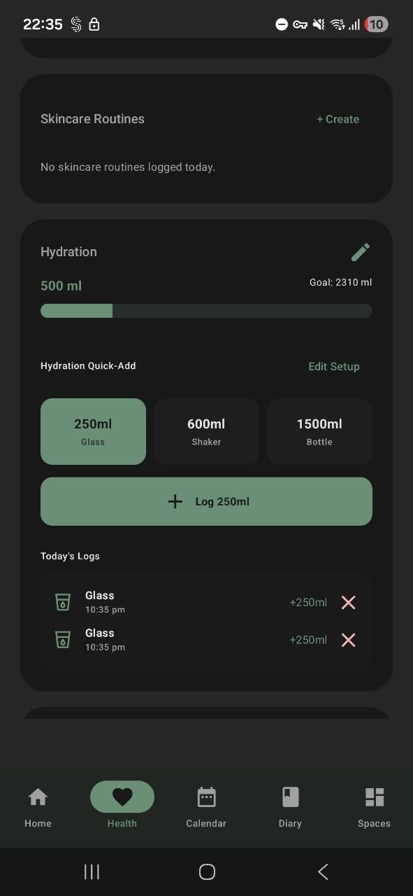 |

| Calendar Day View | Diary & Notes | Space Canvas |
|:---:|:---:|:---:|
|  | 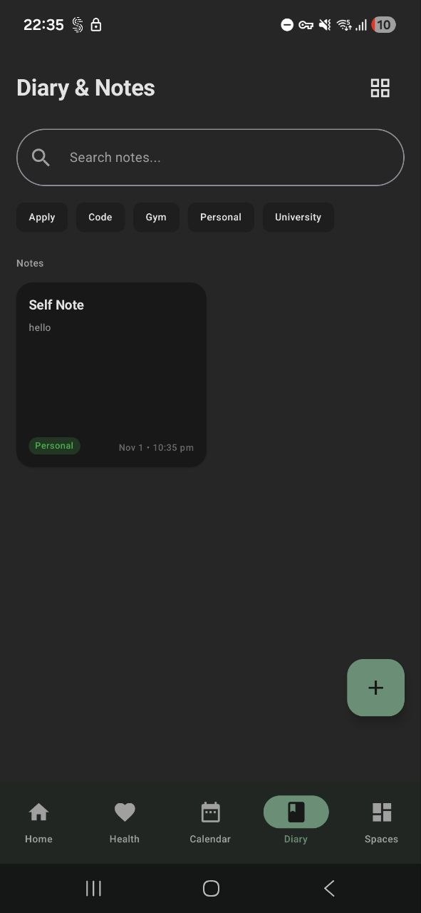 |  |

| Block Menu | Meal Logging | Food Search |
|:---:|:---:|:---:|
| 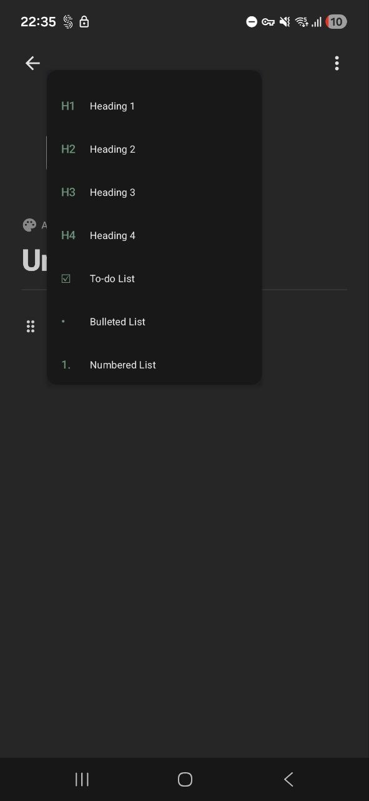 | 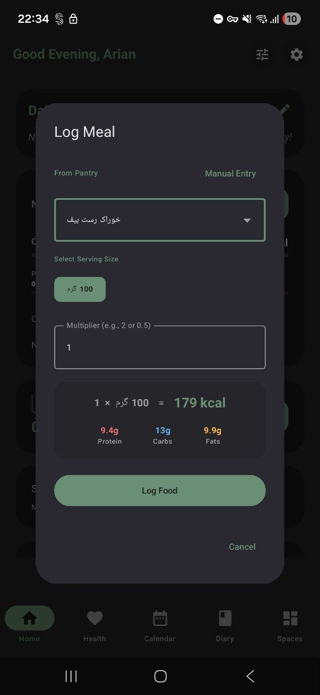 | 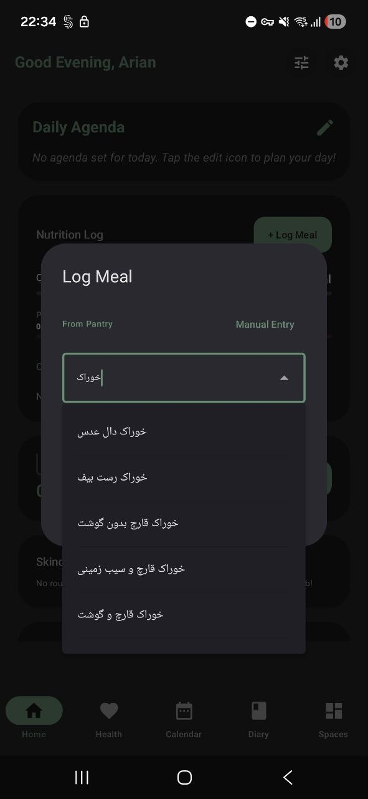 |

---

## 🛠 Tech Stack

| Layer | Technology |
|---|---|
| Language | [Kotlin](https://kotlinlang.org) 2.0, Coroutines, Flow |
| UI | [Jetpack Compose](https://developer.android.com/jetpack/compose), Material Design 3, Navigation Compose |
| Architecture | Clean Architecture, MVVM, Unidirectional Data Flow (`StateFlow` / `SharedFlow`) |
| Dependency Injection | [Hilt](https://dagger.dev/hilt/) |
| Persistence | [Room](https://developer.android.com/training/data-storage/room) (+ Paging), DataStore Preferences |
| Serialization | Kotlinx Serialization (JSON) |
| Background Work | WorkManager (notifications, cleanup) |
| Media | [Coil](https://coil-kt.github.io/coil/), Media3 / ExoPlayer, Palette |
| Security | AndroidX Biometric |
| Web | Jsoup (link previews) |
| Performance | Baseline Profiles |

---

## 🏗 Architecture

Loom follows **Clean Architecture** with **MVVM** and a strict **unidirectional data flow**: Compose screens observe immutable UI state from ViewModels, and user actions flow back down as events.

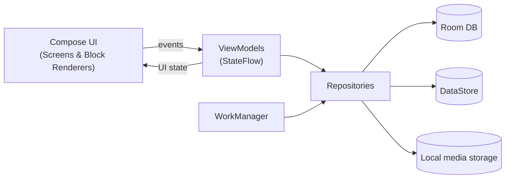

### The block model
Everything in a Space is a `SandboxBlock` — a recursive, serializable tree:

| Field | Purpose |
|---|---|
| `id` / `type` | UUID and one of 30+ `BlockType`s |
| `content` | Primary text |
| `textFormats` | Rich-text spans (`start`, `end`, `type`, `value`) |
| `secondaryContent` | JSON-encoded, block-specific settings (timeline, gallery, database schema…) |
| `children` | Nested blocks — powers cards, toggles and pages-within-pages |
| `isChecked` / `isLocked` | Toggle and freeze state |
| Typed payloads | `tableData`, `kanbanColumns`, `galleryItems`, `calendarEvents`, `sketchStrokes`, … |

Blocks are persisted in Room using Kotlinx Serialization type converters, and each block type is drawn by its own renderer in `ui/sandbox/blocks/`, keeping the canvas itself lightweight.

### Project structure

```
com.example.loom
├── data
│   ├── local          # Room database, DAOs, entities, converters, DataStore preferences
│   ├── models         # SandboxBlock & block models
│   └── repository     # Repositories
├── di                 # Hilt modules
├── ui
│   ├── home           # Dashboard & cards
│   ├── health         # Hydration, nutrition, workout, skincare, bio
│   ├── calendar       # Calendar & events
│   ├── notes          # Diary & note editor
│   ├── sandbox        # Spaces hub, canvas, menus, dialogs
│   │   └── blocks     # One renderer per block type
│   ├── settings       # Settings, backup, security, bug report
│   ├── components     # Shared UI components
│   └── theme          # Material 3 theme, colours, typography
├── util               # Security, templates, syntax highlighting, dates
└── worker             # Notification & cleanup workers
```

---

## 🚀 Getting Started

### Download
Grab the latest APK from the [**Releases**](https://github.com/ArianArsenal/Loom/releases/latest) page and install it on any device running **Android 8.0 (API 26)** or newer.

### Build from source

**Requirements:** Android Studio (latest stable), JDK 17, Android SDK 35.

```bash
git clone https://github.com/ArianArsenal/Loom.git
cd Loom
./gradlew assembleDebug
```

The APK is written to `app/build/outputs/apk/debug/`. Or simply open the project in Android Studio and press **Run**.

> [!NOTE]
> Debug builds use the application ID suffix `.debug`, so they install side by side with the release version instead of conflicting with its signature.

---

## 🤝 Contributing

Bug reports and feature ideas are welcome — please [open an issue](https://github.com/ArianArsenal/Loom/issues). You can also report bugs directly from **Settings → Report a Bug** inside the app.

## 📄 License

Loom is released under the [MIT License](LICENSE).

## 👤 Author

**Arian Mohseni** — [@ArianArsenal](https://github.com/ArianArsenal)

<div align="center">

If you find Loom useful, consider giving it a ⭐

</div>
